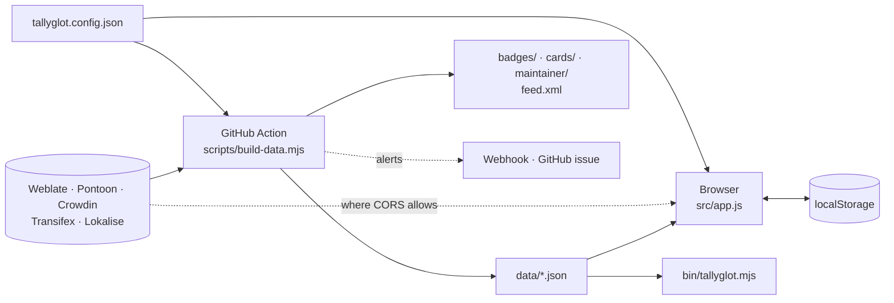

# Architecture

Tallyglot has no backend and no build step. Two things run its code:

- **the browser**, which loads `index.html` and plain ES modules from `src/`;
- **the GitHub Action**, which runs `scripts/build-data.mjs` once a day with Node and commits
  what it writes.

Both import the same modules, so a number means the same thing wherever it is computed.



## Layers

| Layer                | Files                                                                                                                                               | Rule                                                                             |
| -------------------- | --------------------------------------------------------------------------------------------------------------------------------------------------- | -------------------------------------------------------------------------------- |
| Platform access      | `src/api.js`, `src/platforms/*`                                                                                                                     | The only code that knows an API's shape.                                         |
| Domain logic         | `src/core.js`, `stats.js`, `alerts.js`, `findwork.js`, `glossary.js`, `review.js`, `maintainer.js`, `wrapped.js`, `portfolio.js`, `achievements.js` | Pure functions: no DOM, no file system. Network only through a client passed in. |
| Rendering to strings | `src/badge.js`, `card.js`, `charts.js`                                                                                                              | SVG as text, so the Action and the page draw the same picture.                   |
| Browser shell        | `src/app.js`, `ui.js`, `i18n.js`, `store.js`                                                                                                        | Boot, routing, the dashboard, settings.                                          |
| Pages                | `src/views/*`                                                                                                                                       | One module per page, loaded on first visit.                                      |
| Node entry points    | `scripts/*`, `bin/tallyglot.mjs`                                                                                                                    | Read and write files; everything else is imported.                               |

## Platform adapters

An adapter is an object in `src/platforms/` (the interface is documented at the top of
`shared.js`):

```js
export const example = {
  id: 'example',
  ...PLATFORM_META.example, // name and default address, from src/presets.js
  tokenRequired: true, // refuses anonymous requests?
  tokenHint: 'Where to find a token',
  browser: true, // false when the API sends no CORS headers
  languageCode: hyphenated, // "pt_BR" -> how this platform spells it
  createClient: (opts) => new HttpClient({ ...opts, apiRoot: '/v1' }),
  refresh(client, instance, opts) {
    /* -> { entries, errors, limited, … } */
  },
  // optional capabilities
  projectLanguages(client, project) {}, // maintainer view
  catalog(client, { language, cursor, budget }) {}, // find work
};
```

To add a platform: write the module, list it in `src/platforms/index.js` and
`PLATFORM_META`, add fixtures under `test/fixtures/` and a block in
`test/platforms.test.mjs`. `refreshProjects()` in `shared.js` handles rate limits, outages and
"keep the previous numbers" for platforms configured as a list of projects.

`refresh` never throws for a rate limit or an unreachable API. It returns what it got, keeps
earlier entries for the rest, and says so in `limited` / `unreachable` / `errors`.

Every adapter produces the same **entry**: one component of one project in one language
(`id`, `platform`, `project`, `component`, `total`, `translated`, `fuzzy`, `untranslated`,
`failing`, `suggestions`, `comments`, `lastChange`, links). Everything downstream works on
entries and never asks which platform they came from, except to build editor links.

## Files the Action writes

| File                                         | Contents                                               | Read by                           |
| -------------------------------------------- | ------------------------------------------------------ | --------------------------------- |
| `data/snapshot.json`                         | Entries per instance, plus discovery state (`known`)   | dashboard, CLI                    |
| `data/activity.json`                         | Contributions per day, project and user; the 60 latest | Stats, Team, Year in review, card |
| `data/history/<year>.json`                   | One point per day: overall and per-project totals      | charts, milestones                |
| `data/glossary.json`                         | Short source strings and their translations            | Glossary                          |
| `data/findwork.json`                         | Projects of each platform with coverage and stars      | Find work                         |
| `data/alerts.json`, `feed.xml`               | Projects that gained strings                           | Review, feed readers              |
| `data/maintainer/*.json`, `maintainer/*.svg` | Coverage of projects under `maintainer`                | Maintainer view, READMEs          |
| `badges/*.svg`, `cards/*.svg`                | Badges and profile cards                               | READMEs                           |

Files that grow daily (`history`, `glossary`, `findwork`) are written with one map entry per
line (`src/json.js`), which keeps the daily commit small and its diff readable.

### Counting each contribution once

Activity and the glossary come from Weblate's change history, which discovery already walks
(`discover()` in `core.js`). It reports the changes of a user through `onChanges` only after
that user's read position is saved, so a run cut short by a rate limit cannot count a change
twice. `activity.sources` and `glossary.sources` record which configuration the numbers were
collected for; when it changes, or on the first run after upgrading from 1.0, that instance is
dropped and its history is read again from the start.

History and alerts carry an `owner` (language and usernames). A fork starts with its
upstream's files; a different owner clears them.

## The browser app

`app.js` boots in this order: read config, snapshot and locale in parallel → pick, per
instance, the newer of the committed snapshot and the browser's cache → render → refresh live
where the platform allows it.

- **Routing.** `?view=<page>` selects a module from `PAGES`; anything else is the dashboard.
  Links marked `data-nav` are handled with `history.pushState`. A page exports
  `render(ctx)` → HTML and optionally `bind(root, ctx)`. `root` is a fresh element on every
  render, so listeners need no cleanup.
- **`ctx`** gives a page the config, the entries, `ctx.file(name)` for the Action's files
  (fetched once, memoised), saved tokens and navigation.
- **State in the browser** (`localStorage`, prefix `tallyglot:`): `settings` (config
  override), `tokens` (never written anywhere else), `cache`, `prefs`, `glossary-preferred`,
  `findwork`, `setup`.
- **Translations.** `t(key, vars)` returns HTML with variables escaped; `tt()` returns plain
  text. `test/i18n.test.mjs` fails when code uses a missing key or a key is unused.
- **Offline.** `sw.js` answers from the network first and from its cache when the network
  fails. Requests to translation platforms are not intercepted.
- **Loading on demand.** The dashboard loads the shell and the adapters. Each page, its
  stylesheet (`assets/pages.css`), the demo date shifting and the profile card load when
  first needed.

## Tests

| Command            | What runs                                                                                                                                                                                                                           |
| ------------------ | ----------------------------------------------------------------------------------------------------------------------------------------------------------------------------------------------------------------------------------- |
| `npm test`         | Unit tests (`test/`): adapters against recorded responses, the Action's script in a temporary repository, every pure module, contrast of the theme colours, locale coverage, the CLI as a subprocess                                |
| `npm run test:e2e` | Headless Chrome against fake Weblate and Crowdin servers: `e2e/run.mjs` (dashboard, unchanged since 1.0), `e2e/pages.mjs` (everything added in 2.0, offline, accessibility), `e2e/extension.mjs` (extension loads; panel rendering) |

Fixtures in `test/fixtures/` are recorded from the live Weblate and Pontoon APIs. Those for
Crowdin, Transifex and Lokalise are written after their API references, because these APIs
answer only with a token; `scripts/record-fixtures.mjs` replaces them with recordings.

## Decisions

- **No dependencies, no bundler.** Anyone can fork, edit a file and see it live. The cost is
  more small requests on first load; the service worker caches them.
- **The Action is the source of truth; the browser is a convenience.** Several platforms
  cannot be read from a browser at all, and anonymous quotas are small. Pages therefore
  render from committed files and treat live data as a bonus.
- **Tokens never enter the repository.** The Action reads them from a secret; the browser
  keeps them in `localStorage` and "Copy config JSON" leaves them out.
