<div align="center">

<a href="https://armd.one/tallyglot/"></a>

### Everything you translate, on one page

Progress across Weblate, Pontoon, Crowdin, Transifex and Lokalise, with the history,<br>
glossary, review queue and alerts that turn a list of projects into a daily tool.

<br>

[](https://github.com/aubergine-ux/tallyglot/actions/workflows/ci.yml)
[](https://github.com/aubergine-ux/tallyglot/actions/workflows/badges.yml)
[](https://github.com/aubergine-ux/tallyglot/releases)
[](LICENSE)
[](#-platforms)
[](package.json)

**[Live dashboard](https://armd.one/tallyglot/)** &nbsp;·&nbsp;
**[Demo with sample data](https://armd.one/tallyglot/?demo)** &nbsp;·&nbsp;
**[Set up your own](#-set-up-your-own)** &nbsp;·&nbsp;
**[Changelog](CHANGELOG.md)**

<br>

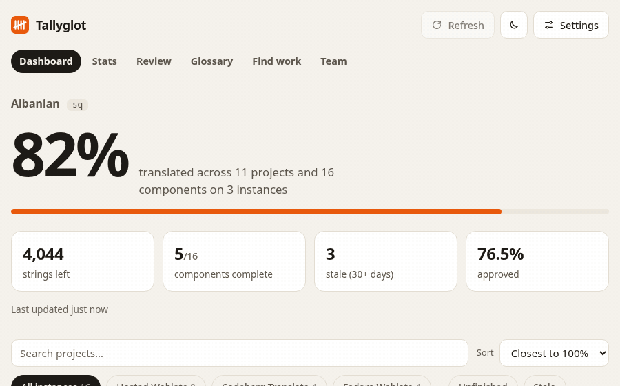

</div>

<br>

## ✨ What it does

<table>
  <tr><td align="center">🌍</td><td><b>Five platforms, one view</b></td><td>Weblate (any instance), Pontoon, Crowdin, Transifex and Lokalise. Every card says where the project lives.</td></tr>
  <tr><td align="center">🎯</td><td><b>Next string, one click</b></td><td>Each card links to the next string that needs you. Sort by closest to 100%, filter by stale or unfinished.</td></tr>
  <tr><td align="center">📈</td><td><b>History and streaks</b></td><td>A contribution calendar, completion over time per project, streaks and milestones, recorded daily.</td></tr>
  <tr><td align="center">📚</td><td><b>Consistency checker</b></td><td>Finds terms you translated more than one way across projects, links to each string, exports your glossary as CSV or TBX.</td></tr>
  <tr><td align="center">✅</td><td><b>Review queue</b></td><td>Failing checks, pending suggestions, strings marked for editing and comments, across every platform.</td></tr>
  <tr><td align="center">🔔</td><td><b>Alerts</b></td><td>When a project adds strings: RSS, a Discord or Slack message, or a GitHub issue. Per project, or as a daily digest.</td></tr>
  <tr><td align="center">🧭</td><td><b>Find work</b></td><td>Open-source projects with little or no coverage in your language, most popular first.</td></tr>
  <tr><td align="center">👥</td><td><b>Team page</b></td><td>A whole language team: every project, a leaderboard, recent activity, what is closest to done.</td></tr>
  <tr><td align="center">🛠️</td><td><b>For maintainers</b></td><td>Coverage of your project in every language, active translators, stale languages, and a README chart that updates itself.</td></tr>
  <tr><td align="center">🪪</td><td><b>Profile card and badges</b></td><td>A README card in four themes that follows light and dark mode, plus a badge per project.</td></tr>
  <tr><td align="center">🎁</td><td><b>Year in review</b></td><td>Your year in numbers, with a share image sized for social media.</td></tr>
  <tr><td align="center">📄</td><td><b>Portfolio</b></td><td>A public page of your translation work, printable as PDF and exportable as JSON Resume.</td></tr>
  <tr><td align="center">🧩</td><td><b>Browser extension</b></td><td>On a GitHub or Codeberg repository: its status in your language and a Translate button.</td></tr>
  <tr><td align="center">⌨️</td><td><b>Command line</b></td><td>A summary in your terminal, or JSON for scripts and dotfiles.</td></tr>
  <tr><td align="center">📦</td><td><b>No backend, no build</b></td><td>Plain HTML, CSS and ES modules on GitHub Pages, data from one scheduled GitHub Action. Zero dependencies.</td></tr>
</table>

<div align="center">
<br>
<picture>
  <source media="(prefers-color-scheme: dark)" srcset="docs/screenshots/dashboard-dark.png">
  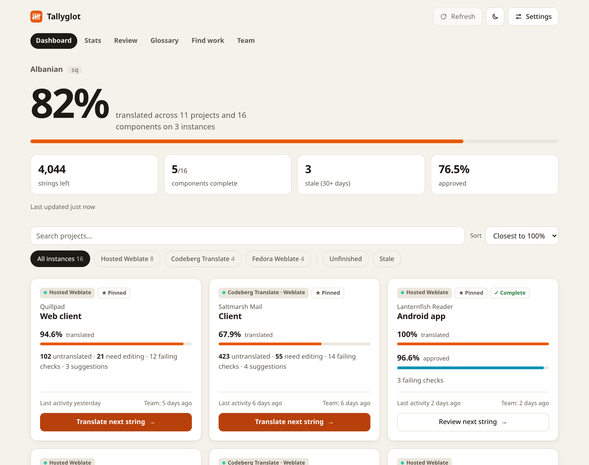
</picture>
</div>

<details>
<summary><b>More screenshots</b></summary>

<br>

| | |
|---|---|
| <picture><source media="(prefers-color-scheme: dark)" srcset="docs/screenshots/stats-dark.png">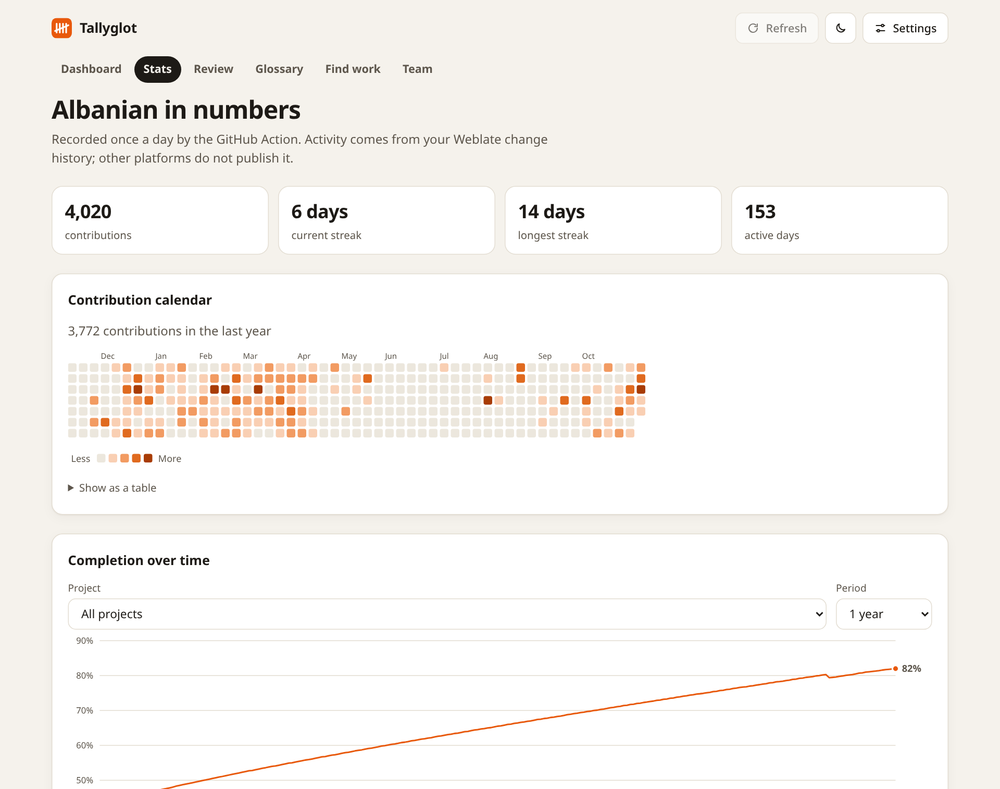</picture><br><sub><b>Stats</b>: calendar, streaks, completion over time</sub> | <picture><source media="(prefers-color-scheme: dark)" srcset="docs/screenshots/glossary-dark.png">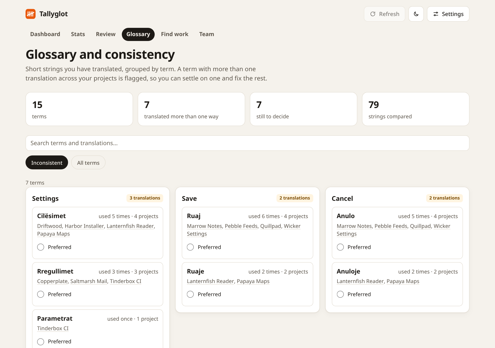</picture><br><sub><b>Glossary</b>: one term, three translations</sub> |
| <picture><source media="(prefers-color-scheme: dark)" srcset="docs/screenshots/review-dark.png">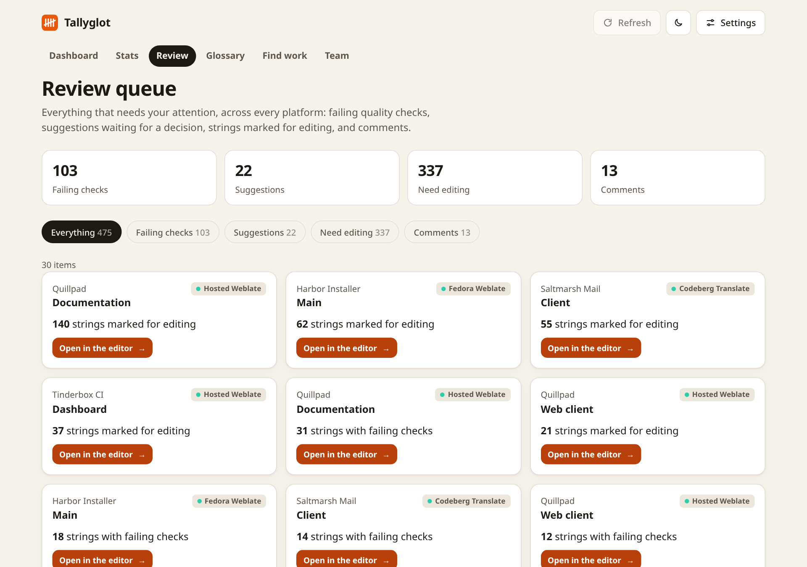</picture><br><sub><b>Review</b>: everything waiting for you</sub> | <picture><source media="(prefers-color-scheme: dark)" srcset="docs/screenshots/find-dark.png">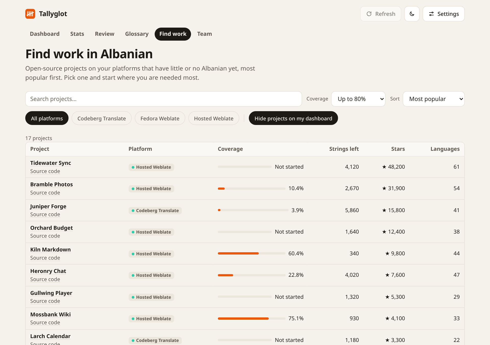</picture><br><sub><b>Find work</b>: where you are needed most</sub> |
| <picture><source media="(prefers-color-scheme: dark)" srcset="docs/screenshots/team-dark.png">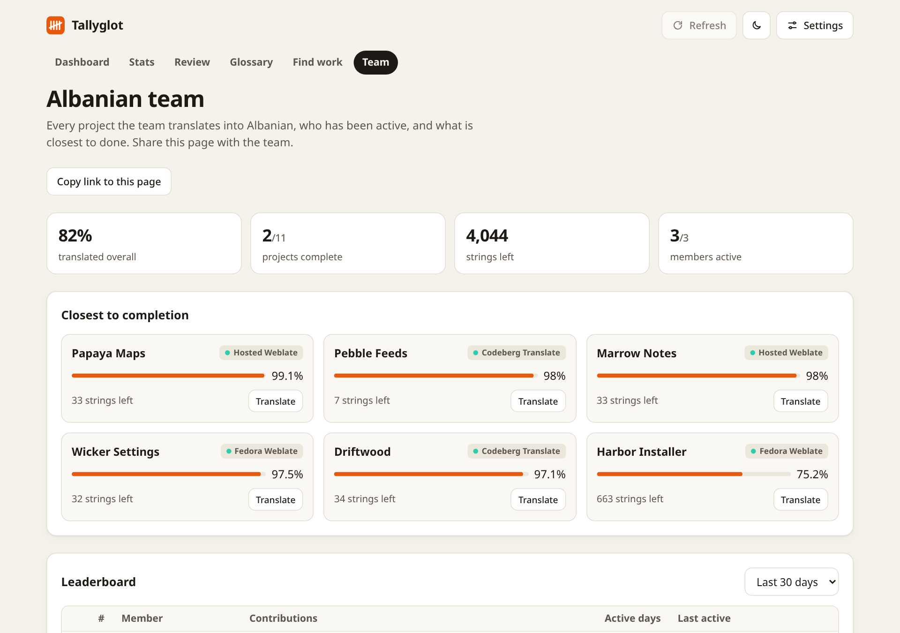</picture><br><sub><b>Team</b>: a language team at a glance</sub> | <picture><source media="(prefers-color-scheme: dark)" srcset="docs/screenshots/wrapped-dark.png">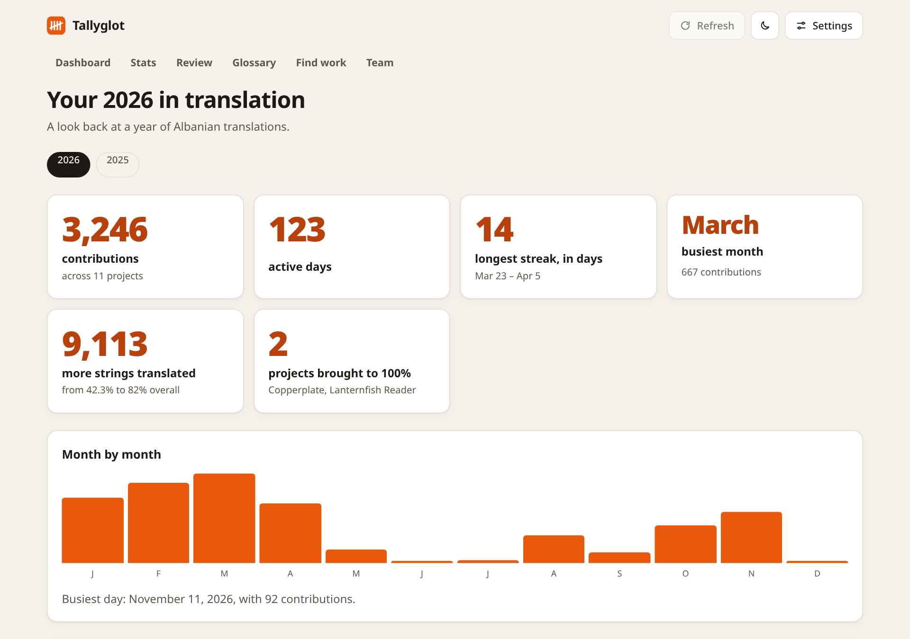</picture><br><sub><b>Year in review</b></sub> |
| <picture><source media="(prefers-color-scheme: dark)" srcset="docs/screenshots/portfolio-dark.png">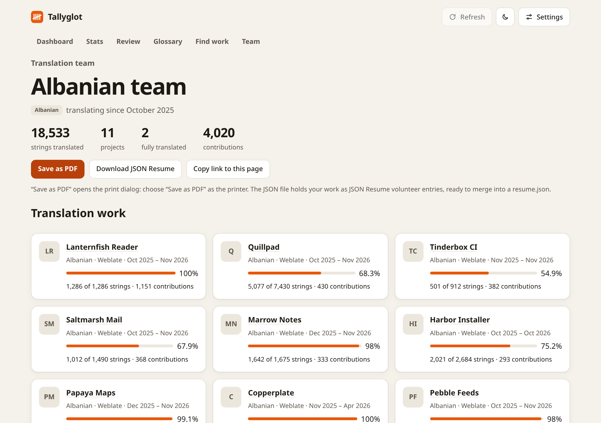</picture><br><sub><b>Portfolio</b>: for a CV or a job application</sub> | <picture><source media="(prefers-color-scheme: dark)" srcset="docs/screenshots/mobile-dark.png">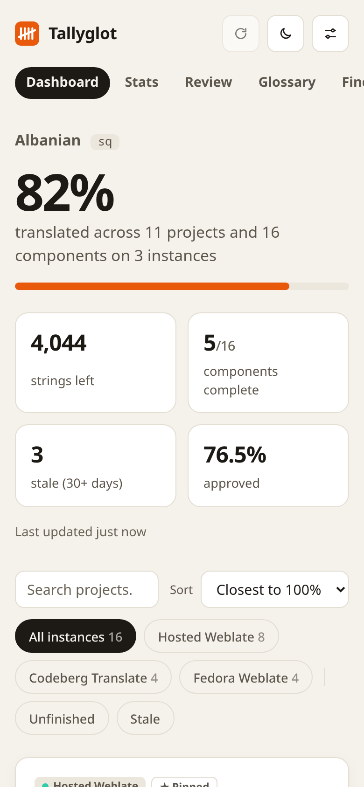</picture><br><sub><b>On a phone</b>; installable, works offline</sub> |

</details>

## 🚀 Set up your own

### In the browser, no terminal

Open **[the guided setup](https://armd.one/tallyglot/?view=setup)**. It asks which language and
platforms you use, builds the configuration, and gives you a link for each step on GitHub:
fork, paste, turn on Pages, start the daily update.

### From a terminal

You need the [GitHub CLI](https://cli.github.com) and [Node.js](https://nodejs.org) 20 or newer.

```sh
gh repo fork aubergine-ux/tallyglot --clone && cd tallyglot && node scripts/setup.mjs
```

The script asks for your language, username and Weblate instances, commits the configuration,
turns on GitHub Pages, starts the first update and prints the address of your dashboard.

<details>
<summary><b>Skip the questions</b></summary>

<br>

```sh
node scripts/setup.mjs --lang sq --user alice --instances hosted,fedora --yes
```

`--instances` takes `hosted`, `codeberg`, `fedora` and/or full addresses, separated by commas.
Other platforms are added in `tallyglot.config.json`, see [Configuration](#%EF%B8%8F-configuration).

</details>

<details>
<summary><b>By hand</b></summary>

<br>

1. Fork this repository.
2. Edit `tallyglot.config.json` and commit.
3. **Settings → Pages:** deploy from branch `main`, folder `/ (root)`.
4. **Actions:** enable workflows, then run **Update badges** once.

</details>

<details>
<summary><b>Just try it, no fork</b></summary>

<br>

Open the [live dashboard](https://armd.one/tallyglot/), click **Settings**, and enter your
language and username. Settings stay in your browser. Platforms that allow browser requests
load live; the pages built from daily records (Stats, Glossary, Find work) need a fork.

</details>

## 🌍 Platforms

| Platform | Finds your projects by | API token | Live in the browser | In the daily Action |
|---|---|:-:|:-:|:-:|
| **Weblate**, any instance | your username | optional | where the instance allows it | ✅ |
| **Pontoon** (Mozilla) | your locale: every project it takes part in | none | ❌ | ✅ |
| **Crowdin** | a list of projects | required | ✅ | ✅ |
| **Transifex** | a list of `organization/project` | required | ✅ | ✅ |
| **Lokalise** | a list of project ids | required | ❌ | ✅ |

Hosted Weblate, Codeberg Translate and Fedora Weblate are built in; add any other Weblate by
address. Platforms marked ❌ send no CORS headers, so the dashboard shows what the Action
recorded.

Contribution history, the glossary and per-string review lists come from Weblate, the only
platform that publishes them. Crowdin, Transifex and Lokalise could not be tested against
their live APIs without a token; their adapters follow the API references and are tested
against responses written from them. Adding a platform is one module: see
[ARCHITECTURE.md](ARCHITECTURE.md#platform-adapters).

## ⚙️ Configuration

A configuration from 1.0 works as it is. The smallest one:

```json
{
  "language": "sq",
  "usernames": ["alice"],
  "instances": [{ "id": "hosted" }]
}
```

<details>
<summary><b>Everything a configuration can hold</b></summary>

<br>

```json
{
  "language": "sq",
  "usernames": ["alice"],
  "displayName": "Alice Example",
  "instances": [
    { "id": "hosted", "pinned": ["weblate/application"] },
    { "id": "codeberg", "usernames": ["alice_cb"] },
    { "url": "https://weblate.example.org", "name": "Example" },
    { "platform": "pontoon", "projects": ["firefox", "thunderbird"] },
    { "platform": "crowdin", "projects": ["kestrel-notes"] },
    { "platform": "transifex", "projects": ["heron/heron-desktop"], "language": "sq_AL" },
    { "platform": "lokalise", "projects": ["3002780358964f9bab5a92.87762432"] }
  ],
  "team": { "name": "Albanian team" },
  "alerts": {
    "channels": ["rss", "webhook"],
    "digest": true,
    "minStrings": 5,
    "projects": {
      "hosted:weblate": false,
      "crowdin:kestrel-notes": { "channels": ["issue"], "minStrings": 1 }
    }
  },
  "findWork": { "maxPercent": 80, "requestsPerRun": 15 },
  "maintainer": [{ "instance": "hosted", "project": "weblate" }],
  "staleDays": 30,
  "cacheHours": 12
}
```

| Key | What it does |
|---|---|
| `language` | Language code as the platform writes it: `sq`, `pt_BR`, `zh_Hans`. |
| `usernames` | Your Weblate username(s). For a team, every member. |
| `displayName` | Your name on the profile card and the portfolio. |
| `instances[].id` | `hosted`, `codeberg` or `fedora` for the built-in Weblate instances. |
| `instances[].url` | Address of any other Weblate instance. `name` is optional. |
| `instances[].platform` | `pontoon`, `crowdin`, `transifex` or `lokalise`. Left out means Weblate. |
| `instances[].projects` | Projects to track on that platform. On Pontoon, leave it out for all projects of your locale. |
| `instances[].pinned` | Weblate: always show these, even without contributions (`project` or `project/component`). |
| `instances[].usernames` | Weblate: when your username differs on that instance. |
| `instances[].language` | When that platform spells your language differently. |
| `team.name` | Turns on team wording and titles the [team page](#teams). |
| `alerts.channels` | Any of `rss`, `webhook`, `issue`. Default `["rss"]`. |
| `alerts.digest` | `true`: one message a day. `false`: one per project. |
| `alerts.minStrings` | Ignore additions smaller than this. |
| `alerts.projects` | Per project (`instance:project`): `false` to mute, or its own `channels` / `minStrings`. |
| `findWork.maxPercent` | Coverage at or below which a project is offered. Default `80`. |
| `findWork.requestsPerRun` | Requests the Action may spend per platform per day on the index. `"enabled": false` turns it off. |
| `maintainer` | Projects to draw README charts for, see [For maintainers](#maintainers). |
| `staleDays` | Days without activity before an unfinished component counts as stale. Default `30`. |
| `cacheHours` | How long the browser trusts its cache. Default `12`. |
| `discoveryPages` | Thousands of Weblate changes read per run. Default `3`. |
| `badgeLabel` | Left-hand text of the overall badge. |

</details>

<details>
<summary><b>Secrets for the Action</b></summary>

<br>

Under **Settings → Secrets and variables → Actions** of your fork:

| Name | Kind | Holds |
|---|---|---|
| `TALLYGLOT_TOKENS` | secret | API tokens as JSON keyed by instance id: `{"hosted":"wlu_…","crowdin":"…"}`. Optional for Weblate (lifts the limit of 100 requests a day), required for Crowdin, Transifex and Lokalise. `WEBLATE_TOKENS` from 1.0 still works. |
| `ALERT_WEBHOOK_URL` | secret | A Discord or Slack incoming webhook, for the `webhook` alert channel. |
| `SITE_URL` | variable | Your dashboard's address, if it is not `https://<you>.github.io/<repo>/`. Used in alert links. |

Tokens never enter the repository. In the browser they are kept in `localStorage` and sent
only to the platform they belong to.

</details>

## 📖 Using it

| You want to | Go to |
|---|---|
| Finish what is nearly done | **Dashboard**, sorted by *Closest to 100%* |
| See your streak, calendar and progress over time | **Stats** |
| Deal with failing checks, suggestions and comments | **Review** |
| Stop translating "Settings" three different ways | **Glossary** |
| Find a project that needs your language | **Find work** |
| See how the team is doing | **Team** |
| Put your work on a CV | **Portfolio** → Save as PDF, or Download JSON Resume |
| Look back on the year | **Year in review**, linked from the dashboard in December and January |
| Check your own project's coverage | **For maintainers** |

<details>
<summary><b>📈 Stats, achievements and the profile card</b></summary>

<br>

The daily Action records where every project stood (`data/history/`) and reads your Weblate
change history (`data/activity.json`). From those the **Stats** page draws a contribution
calendar, completion over time for all projects or one, streaks, milestones ("Hit 100% on 2
projects this month") and a short list of achievements.

The profile card is redrawn every day in four themes. This snippet shows the dark card to
readers in dark mode and the light one to everyone else:

```html
<a href="https://<you>.github.io/tallyglot/">
  <picture>
    <source media="(prefers-color-scheme: dark)" srcset="https://<you>.github.io/tallyglot/cards/dark.svg">
    .github.io/tallyglot/cards/light.svg" alt="Translation stats">
  </picture>
</a>
```

<div align="center">
<picture>
  <source media="(prefers-color-scheme: dark)" srcset="cards/dark.svg">
  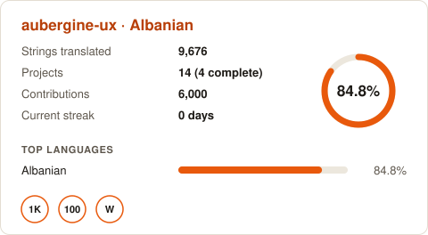
</picture>
</div>

Other themes: `aubergine-light.svg` / `aubergine-dark.svg`, `ocean-…`, `mono-…`. The Stats page
has the snippet for each, ready to copy. Badges work as before:

```md
[](https://<you>.github.io/tallyglot/)
```

</details>

<details>
<summary><b>🔔 Alerts</b></summary>

<br>

Each day the Action compares every project with the day before. A project whose source grew
and that has more strings waiting is reported to the channels you chose:

- **`rss`** (default): `feed.xml` next to your dashboard. Subscribe in any feed reader.
- **`webhook`**: a message to Discord or Slack. Add the webhook address as the secret
  `ALERT_WEBHOOK_URL`.
- **`issue`**: an issue in your fork, labelled `translations`.

`"digest": true` sends one summary; `false` sends one message per project. Mute a project or
give it its own channels under `alerts.projects`. The **Review** page lists recent alerts.

</details>

<details>
<summary><b>🧭 Find work</b></summary>

<br>

The Action reads a few projects of each platform's directory every day, within the request
limit, and keeps their coverage in your language in `data/findwork.json`. Star counts come
from GitHub, Codeberg and GitLab. The **Find work** page ranks them by popularity and hides
what is already on your dashboard. On platforms that allow browser requests, **Read more
now** extends the index on the spot.

Weblate and Pontoon are searchable. Crowdin, Transifex and Lokalise have no public project
directory in their APIs.

</details>

<details>
<summary><b>📚 Glossary and consistency</b></summary>

<br>

Short source strings (up to four words) are treated as terms. "Settings", "settings…" and
"&Settings" count as one term; a term with more than one translation across your projects is
flagged, with a link to each string. Choose a preferred translation (kept in your browser),
then export:

- **CSV** with a `source,target` header, for Weblate's glossary import;
- **TBX**, for any other tool.

</details>

<details>
<summary><b>✅ Review queue</b></summary>

<br>

One item per component and kind: failing checks, suggestions, strings marked for editing,
comments. Each opens the platform's editor filtered to exactly those strings. On Weblate,
**Show the strings** lists them in place, one request per list. Where a platform needs a
token, add it under **Settings**; it stays in that browser.

</details>

<details id="teams">
<summary><b>👥 For language teams</b></summary>

<br>

List every member under `usernames` and give the team a name:

```json
{ "language": "sq", "usernames": ["alice", "besnik", "mira"], "team": { "name": "Albanian team" }, "instances": [{ "id": "hosted" }] }
```

`https://<you>.github.io/tallyglot/?view=team` then shows every project the team translates,
the projects closest to completion, a leaderboard for the last week, month, year or all time,
and recent activity.

</details>

<details id="maintainers">
<summary><b>🛠️ For maintainers</b></summary>

<br>

Open **For maintainers**, enter your project, and share the address. It needs no setup:

```
https://armd.one/tallyglot/?view=maintainer&platform=weblate&instance=hosted&project=<your-project>
```

For a chart and badge in your README that update themselves, list the project in a Tallyglot
configuration (a fork with nothing else in it is enough):

```json
{ "instances": [{ "id": "hosted" }], "maintainer": [{ "instance": "hosted", "project": "<your-project>" }] }
```

The Action then writes `maintainer/hosted--<your-project>.svg`, a `-dark.svg` variant and a
`-badge.svg`. The page shows the snippet to copy.

</details>

<details>
<summary><b>🧩 Browser extension</b></summary>

<br>

Shows a repository's translation status for your language on GitHub and Codeberg, and notices
projects that have translation files but no platform. It is not in the browser stores yet;
load it from the [`extension`](extension) folder:

- **Chrome:** `chrome://extensions` → Developer mode → **Load unpacked** → the `extension` folder.
- **Firefox:** `about:debugging#/runtime/this-firefox` → **Load Temporary Add-on** → `extension/manifest.json`.

Details and permissions: [extension/README.md](extension/README.md).

</details>

<details>
<summary><b>⌨️ Command line</b></summary>

<br>

```sh
# from a published dashboard: no API requests, good for dotfiles
npx github:aubergine-ux/tallyglot --url https://<you>.github.io/tallyglot/

# straight from Weblate
npx github:aubergine-ux/tallyglot --lang sq --user alice

# in a clone of your fork
node bin/tallyglot.mjs
node bin/tallyglot.mjs --json | jq .percent
```

```
  Tallyglot  Albanian (sq)

  ████████████████████████████████████████████████████████░░░░░░░░░░ 84.8%
  9,676 of 11,404 strings · 14 projects · 4 complete · 1,728 left

  Thunder               █████████████████████████████████  99.4%  5 left
  F-Droid               ████████████████████████████████░  97.6%  11 left
  trale                 ████████████████████████████████░  96.6%  9 left
```

`--help` lists every option. Colour turns itself off when the output is piped or `NO_COLOR`
is set. The package is not on npm yet, which is why the examples name the repository.

</details>

<details>
<summary><b>📲 Install, offline, accessibility, languages</b></summary>

<br>

- **Install it.** Tallyglot is a PWA: use *Install* in your browser's menu, or *Add to Home
  Screen* on a phone.
- **Offline.** The last data you saw stays available without a connection.
- **Accessibility.** Everything works from the keyboard, charts included (arrow keys read
  each day); controls and images have names; colours meet WCAG AA; animation stops when your
  system asks for reduced motion.
- **Interface language.** English for now. The strings are in [`locales/`](locales), ready
  for translation: see [docs/TRANSLATING.md](docs/TRANSLATING.md).

</details>

## 🧭 How it works

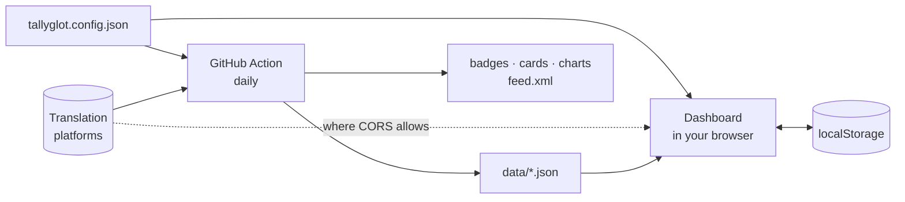

The dashboard shows what the Action committed, refreshes live where it can, and keeps
whichever copy is newer. The same modules run in both places.
**[ARCHITECTURE.md](ARCHITECTURE.md)** has the details.

<details>
<summary><b>Rate limits</b></summary>

<br>

Weblate allows **100 anonymous API requests per day** per address. A daily refresh costs one
request per component (two with reviews) plus one to three per username; what is left goes to
the Find work index. When the limit is hit, saved numbers stay in place and the next run
starts with what has waited longest. An API token (5000 requests per hour) removes the worry:
add it to `TALLYGLOT_TOKENS`, and under **Settings** for the browser.

</details>

<details>
<summary><b>The daily bot commit</b></summary>

<br>

Badges, cards and history have to be files, so the workflow commits them once a day as
`github-actions[bot]`. For a weekly rhythm, change the `cron` line in
`.github/workflows/badges.yml` to `'17 5 * * 1'`; history then has a point per week.

</details>

## 🛠️ Development

Nothing to install: there are no dependencies.

```sh
npm start            # preview at http://127.0.0.1:8080 (add ?demo for sample data)
npm test             # unit tests
npm run test:e2e     # headless Chrome: dashboard, pages, offline, accessibility, extension
npm run build-data   # what the Action runs
npm run demo-data    # regenerate the sample data
npm run format       # prettier
```

<details>
<summary><b>Project layout</b></summary>

<br>

```
index.html  sw.js  manifest.webmanifest   app shell, service worker, PWA manifest
tallyglot.config.json                     your settings
assets/                                   styles and icons
locales/                                  interface strings
src/platforms/                            one adapter per platform
src/*.js                                  logic shared by the browser, the Action and the CLI
src/views/                                one module per page, loaded on demand
scripts/build-data.mjs                    everything the Action writes
scripts/setup.mjs                         one-command configuration
bin/tallyglot.mjs                         the command-line tool
extension/                                the browser extension
test/  e2e/                               unit and browser tests
data/  badges/  cards/  feed.xml          written by the Action
```

</details>

Issues and pull requests are welcome. Translations of the interface especially: see
[docs/TRANSLATING.md](docs/TRANSLATING.md).

<br>

---

<div align="center">

Released under the [MIT License](LICENSE)

Thank you to everyone who translates free software.

Made by [@aubergine-ux](https://github.com/aubergine-ux)

</div>
