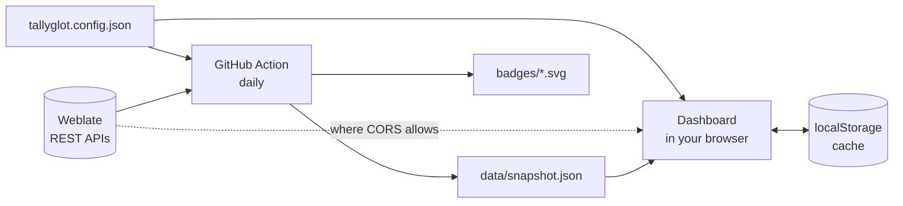

<div align="center">


### One dashboard for every Weblate project you translate

Enter a language and your Weblate username. See every component you contribute to,<br>
how complete each one is, and jump straight to the next string that needs you.

<br>

[](https://armd.one/tallyglot/)
[](https://github.com/aubergine-ux/tallyglot/actions/workflows/badges.yml)
[](LICENSE)


**[Live dashboard](https://armd.one/tallyglot/)** &nbsp;·&nbsp;
**[Demo with sample data](https://armd.one/tallyglot/?demo)** &nbsp;·&nbsp;
**[Set up your own](#-set-up-your-own-in-5-minutes)**

<br>

<picture>
  <source media="(prefers-color-scheme: dark)" srcset="docs/screenshots/dashboard-dark.png">
  
</picture>

</div>

<br>

## ✨ What you get

| | |
|---|---|
| 🌍 **Many instances, one view** | Hosted Weblate, Codeberg Translate and Fedora Weblate are built in. Add any other Weblate by URL. |
| 🃏 **A card per component** | % translated, % approved, untranslated count, last activity, your own last contribution, and a button that opens the next untranslated string. |
| 🔎 **Sort and filter** | By completion, closest to 100%, fewest strings left, recently active or longest inactive. Filter by instance, unfinished, or stale (30+ days quiet). |
| 🏷️ **Badges for your README** | An overall badge plus one per project, rendered as static SVGs by a scheduled GitHub Action. |
| 🧾 **Config in one JSON file** | Language, usernames, instances and pinned projects live in `tallyglot.config.json`. |
| ⚡ **Kind to the API** | Responses are cached in the browser with a "last updated" time. Rate limits are detected and the dashboard keeps showing saved data. |
| 🌗 **Light and dark** | Mobile-first layout, themes built on CSS custom properties. |
| 📦 **No backend, no build** | Plain HTML, CSS and ES modules. Fork it and GitHub Pages serves it as is. |

<div align="center">
<picture>
  <source media="(prefers-color-scheme: dark)" srcset="docs/screenshots/mobile-dark.png">
  
</picture>
</div>

## 🚀 Set up your own in 5 minutes

You need the [GitHub CLI](https://cli.github.com) and Node.js 20 or newer.

```sh
gh repo fork aubergine-ux/tallyglot --clone && cd tallyglot && node scripts/setup.mjs
```

The script asks for your language code, username and instances, then:

1. writes `tallyglot.config.json`
2. commits and pushes it to your fork
3. turns on GitHub Pages
4. enables the badge workflow and starts its first run

A minute or two later your dashboard is live at `https://<you>.github.io/tallyglot/`.

<details>
<summary><b>Prefer to do it by hand?</b></summary>

<br>

1. Fork this repository.
2. Edit `tallyglot.config.json` (see below) and commit.
3. **Settings → Pages →** deploy from branch `main`, folder `/ (root)`.
4. **Actions →** enable workflows, then run **Update badges** once.

</details>

<details>
<summary><b>Just want to try it?</b></summary>

<br>

Open the [live dashboard](https://armd.one/tallyglot/), click **Settings**, and enter your
language and username. These settings stay in your browser. Instances that allow browser requests
(Hosted Weblate does) load live; the others need the snapshot from your own fork.

</details>

## ⚙️ Configuration

```json
{
  "language": "sq",
  "usernames": ["alice"],
  "instances": [
    { "id": "hosted", "pinned": ["weblate/application"] },
    { "id": "codeberg", "usernames": ["alice_cb"] },
    { "id": "fedora" },
    { "url": "https://weblate.example.org", "name": "Example" }
  ],
  "staleDays": 30,
  "cacheHours": 12
}
```

| Key | What it does |
|---|---|
| `language` | Language code exactly as it appears in Weblate URLs: `sq`, `pt_BR`, `zh_Hans`. |
| `usernames` | Your Weblate username(s). Used for every instance unless that instance sets its own. |
| `instances[].id` | `hosted`, `codeberg` or `fedora` for the built-in instances. |
| `instances[].url` | Address of any other Weblate instance. `name` is optional. |
| `instances[].usernames` | Override when your username differs on that instance. |
| `instances[].pinned` | Always show these, even if you never contributed: `project/component`, or `project` for all its components. Pinned cards sort first. |
| `staleDays` | Days without activity before an unfinished component counts as stale. Default `30`. |
| `cacheHours` | How long the browser trusts its cache before refreshing. Default `12`. |
| `badgeLabel` | Left-hand text of the overall badge. Defaults to the language name. |

## 🏷️ Badges

The **Update badges** workflow runs once a day (and whenever the config changes). It writes
`badges/overall.svg` and one `badges/<instance>--<project>.svg` per project, then commits them,
so they are plain image URLs that work anywhere:

```md
[](https://<you>.github.io/tallyglot/)
```

[](https://armd.one/tallyglot/)

The dashboard has a **Badges** section with ready-to-copy Markdown for each one.

## 🧭 How it works



Everything uses the public, read-only Weblate API:

| Step | Endpoint |
|---|---|
| Find what you translate | `GET /api/changes/?user=<name>&action=…` and keep the translations in your language. After the first run only newer changes are read. |
| Stats for a component | `GET /api/translations/<project>/<component>/<lang>/` |
| Approved strings | `GET /api/translations/…/statistics/`, only for projects with reviews turned on |
| Expand a pinned project | `GET /api/projects/<project>/components/` (cached for a week) |

The dashboard shows the committed snapshot immediately, then refreshes live where it can and
keeps whichever copy is newer.

### Rate limits

Weblate allows **100 anonymous API requests per day** per address. Tallyglot spends one request
per component (two if the project uses reviews) plus one per username, so a daily refresh of a
few dozen components fits. When the limit is hit, the dashboard says so, keeps the saved data,
and picks up the least recently refreshed components first next time.

Need more? Create an API token in your Weblate profile (5000 requests/hour):

- **Browser:** paste it under **Settings**. It is stored in your browser only and never leaves it except to that instance.
- **Action:** add a repository secret named `WEBLATE_TOKENS` holding JSON keyed by instance id, for example `{"hosted":"wlu_…","fedora":"wlu_…"}`.

### Which instances refresh live?

Browsers can only read an API that sends CORS headers.

| Instance | Live in the browser | Via the snapshot |
|---|:---:|:---:|
| Hosted Weblate | ✅ | ✅ |
| Codeberg Translate | ❌ | ✅ |
| Fedora Weblate | ❌ | ✅ |
| Your own instance | depends on its version and setup | ✅ |

## 🛠️ Development

No dependencies to install.

```sh
npm start            # serve on http://localhost:8080
npm test             # unit tests (node --test)
npm run build-data   # fetch stats, write data/snapshot.json and badges/
npm run demo-data    # regenerate the sample data behind ?demo
```

```
index.html                 app shell
tallyglot.config.json      your settings
assets/styles.css          layout and themes (CSS custom properties)
src/api.js                 Weblate REST client, rate-limit handling
src/core.js                discovery, stats, sorting (shared by browser and Node)
src/badge.js               SVG badge renderer
src/app.js                 dashboard UI
scripts/build-data.mjs     what the GitHub Action runs
scripts/setup.mjs          one-command configuration
```

Issues and pull requests are welcome.

## 📄 License

[MIT](LICENSE)
