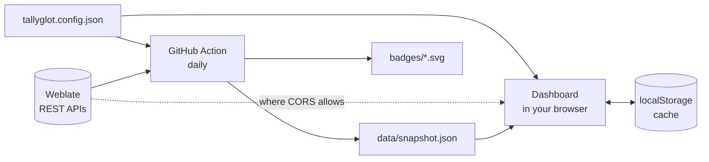

<div align="center">

<a href="https://armd.one/tallyglot/"></a>

### One dashboard for every Weblate project you translate

Enter a language and your Weblate username. See every component you contribute to,<br>
how complete each one is, and jump straight to the next string that needs you.

<br>

[](https://github.com/aubergine-ux/tallyglot/actions/workflows/ci.yml)
[](https://github.com/aubergine-ux/tallyglot/actions/workflows/badges.yml)
[](https://github.com/aubergine-ux/tallyglot/releases)
[](LICENSE)
[](https://github.com/aubergine-ux/tallyglot)
[](package.json)

**[Live dashboard](https://armd.one/tallyglot/)** &nbsp;·&nbsp;
**[Demo with sample data](https://armd.one/tallyglot/?demo)** &nbsp;·&nbsp;
**[Set up your own](#-set-up-your-own-in-5-minutes)**

<br>

<picture>
  <source media="(prefers-color-scheme: dark)" srcset="docs/screenshots/dashboard-dark.png">
  
</picture>

</div>

<br>

## ✨ Features

| | | |
|:-:|---|---|
| 🌍 | **Many instances, one view** | Hosted Weblate, Codeberg Translate and Fedora Weblate are built in. Add any other Weblate by URL. |
| 🃏 | **A card per component** | % translated, % approved, untranslated count, last activity, your own last contribution. |
| 🎯 | **Next string, one click** | Every card links straight to the next untranslated string in Weblate's editor. |
| 🔎 | **Sort and filter** | Closest to 100%, least or most complete, fewest strings left, recently active. Filter by instance, unfinished, or stale. |
| 🏷️ | **Badges for your README** | An overall badge plus one per project, kept fresh by a scheduled GitHub Action. |
| 🧾 | **One JSON config** | Language, usernames, instances and pinned projects in `tallyglot.config.json`. |
| ⚡ | **Kind to the API** | Cached in your browser with a "last updated" time. Rate limits are detected and saved data stays on screen. |
| 🌗 | **Light and dark** | Mobile-first, themed with CSS custom properties. |
| 📦 | **No backend, no build** | Plain HTML, CSS and ES modules. Zero dependencies. GitHub Pages serves it as is. |

<div align="center">
<br>

<br><br>
<picture>
  <source media="(prefers-color-scheme: dark)" srcset="docs/screenshots/mobile-dark.png">
  
</picture>
</div>

## 🚀 Set up your own in 5 minutes

You need the [GitHub CLI](https://cli.github.com) and [Node.js](https://nodejs.org) 20 or newer.

```sh
gh repo fork aubergine-ux/tallyglot --clone && cd tallyglot && node scripts/setup.mjs
```

The script asks for your language code, username and instances, then:

1. writes `tallyglot.config.json`
2. commits and pushes it to your fork
3. turns on GitHub Pages
4. enables the badge workflow and starts its first run

A minute or two later it prints the address of your dashboard and the Markdown for your badge.

<details>
<summary><b>Skip the questions</b></summary>

<br>

```sh
node scripts/setup.mjs --lang sq --user alice --instances hosted,fedora --yes
```

`--instances` takes `hosted`, `codeberg`, `fedora` and/or full URLs, separated by commas.

</details>

<details>
<summary><b>Do it by hand</b></summary>

<br>

1. Fork this repository.
2. Edit `tallyglot.config.json` (see [Configuration](#%EF%B8%8F-configuration)) and commit.
3. **Settings → Pages:** deploy from branch `main`, folder `/ (root)`.
4. **Actions:** enable workflows, then run **Update badges** once.

</details>

<details>
<summary><b>Just try it, no fork</b></summary>

<br>

Open the [live dashboard](https://armd.one/tallyglot/), click **Settings**, and enter your language and
username. Settings stay in your browser. Instances that allow browser requests load live
(Hosted Weblate does); the others need a fork, see
[which instances refresh live](#which-instances-refresh-live).

</details>

## 📖 Using the dashboard

| You want to | Do this |
|---|---|
| Finish what is nearly done | Sort by **Closest to 100%** (the default) |
| Find neglected translations | Turn on **Stale**: unfinished and quiet for 30+ days |
| Focus on one platform | Click an instance chip |
| Keep a project on top | Add it under **Pinned projects** in Settings, or `pinned` in the config |
| Translate | **Translate next string →** opens Weblate on the first untranslated string |
| Get fresh numbers | **Refresh**. Data also refreshes by itself once it is older than `cacheHours` |
| Make browser settings permanent | Settings → **Copy config JSON**, commit it as `tallyglot.config.json` |

## ⚙️ Configuration

```json
{
  "language": "sq",
  "usernames": ["alice"],
  "instances": [
    { "id": "hosted", "pinned": ["weblate/application"] },
    { "id": "codeberg", "usernames": ["alice_cb"] },
    { "id": "fedora" },
    { "url": "https://weblate.example.org", "name": "Example" }
  ],
  "staleDays": 30,
  "cacheHours": 12
}
```

| Key | What it does |
|---|---|
| `language` | Language code exactly as it appears in Weblate URLs: `sq`, `pt_BR`, `zh_Hans`. |
| `usernames` | Your Weblate username(s). Used for every instance unless that instance sets its own. |
| `instances[].id` | `hosted`, `codeberg` or `fedora` for the built-in instances. |
| `instances[].url` | Address of any other Weblate instance. `name` is optional. |
| `instances[].usernames` | Override when your username differs on that instance. |
| `instances[].pinned` | Always show these, even without contributions: `project/component`, or `project` for all its components. Pinned cards sort first. |
| `staleDays` | Days without activity before an unfinished component counts as stale. Default `30`. |
| `cacheHours` | How long the browser trusts its cache before refreshing. Default `12`. |
| `discoveryPages` | How many thousand changes of your history to read per run. Default `3`. |
| `badgeLabel` | Left-hand text of the overall badge. Defaults to the language name. |

## 🏷️ Badges

The **Update badges** workflow runs once a day and whenever the config changes. It writes
`badges/overall.svg` and one `badges/<instance>--<project>.svg` per project, then commits them,
so they are plain image URLs that work anywhere:

```md
[](https://<you>.github.io/tallyglot/)
```

<div align="center">

[](https://armd.one/tallyglot/)
&nbsp;
[](https://armd.one/tallyglot/)

</div>

The dashboard's **Badges** section has ready-to-copy Markdown for each one.

## 🧭 How it works



The dashboard shows the committed snapshot immediately, refreshes live where it can, and keeps
whichever copy is newer.

<details>
<summary><b>API endpoints used</b></summary>

<br>

Everything goes through the public, read-only [Weblate REST API](https://docs.weblate.org/en/latest/api.html).

| Step | Endpoint |
|---|---|
| Find what you translate | `GET /api/changes/?user=<name>&action=…`, keeping translations in your language |
| Stats for a component | `GET /api/translations/<project>/<component>/<lang>/` |
| Approved strings | `GET /api/translations/…/statistics/`, only for projects with reviews turned on |
| Expand a pinned project | `GET /api/projects/<project>/components/`, cached for a week |

The first run reads your most recent changes. Later runs read only what is new, plus another
slice of older history until all of it has been seen, so long-time translators see their list
fill in over a few runs. Pin a project to show it right away.

</details>

<details>
<summary><b>Rate limits and API tokens</b></summary>

<br>

Weblate allows **100 anonymous API requests per day** per address. Tallyglot spends one request
per component (two if the project uses reviews) plus one or two per username, so a daily refresh
of a few dozen components fits. When the limit is hit the dashboard says so, keeps the saved
data, and next time starts with the components that have waited longest.

For more, create an API token in your Weblate profile (5000 requests per hour):

- **Browser:** paste it under **Settings**. It is stored in your browser and only ever sent to that instance.
- **Action:** add a repository secret named `WEBLATE_TOKENS` with JSON keyed by instance id:
  `{"hosted":"wlu_…","codeberg":"wlu_…"}`

</details>

<details>
<summary><b>The daily bot commit</b></summary>

<br>

Badges need to be static files, so the workflow commits `data/` and `badges/` once a day as
`github-actions[bot]`. To make it weekly, change the `cron` line in
`.github/workflows/badges.yml` to `'17 5 * * 1'`.

</details>

### Which instances refresh live?

Browsers can only read an API that sends CORS headers. The snapshot from the Action covers the rest.

| Instance | Live in the browser | Via the Action | Notes |
|---|:-:|:-:|---|
| Hosted Weblate | ✅ | ✅ | |
| Fedora Weblate | ❌ | ✅ | |
| Codeberg Translate | ❌ | ✅ | Its anonymous quota is often used up, so add a token to `WEBLATE_TOKENS` |
| Your own instance | depends on its setup | ✅ | |

## 🛠️ Development

Nothing to install: there are no dependencies.

```sh
npm start            # preview at http://127.0.0.1:8080 (add ?demo for sample data)
npm test             # unit tests
npm run test:e2e     # drives the app in headless Chrome against a fake Weblate
npm run build-data   # what the Action runs: writes data/snapshot.json and badges/
npm run format       # prettier
```

<details>
<summary><b>Project layout</b></summary>

<br>

```
index.html                 app shell
tallyglot.config.json      your settings
assets/styles.css          layout and themes (CSS custom properties)
src/api.js                 Weblate REST client, rate-limit handling
src/core.js                discovery, stats, sorting (shared by browser and Node)
src/badge.js               SVG badge renderer
src/app.js                 dashboard UI
scripts/build-data.mjs     snapshot + badges, run by the Action
scripts/setup.mjs          one-command configuration
scripts/serve.mjs          local preview server
test/  e2e/                unit and browser tests
```

</details>

Issues and pull requests are welcome.

<br>

---

<div align="center">

Released under the [MIT License](LICENSE)

Built on the [Weblate](https://weblate.org) REST API. Thank you to everyone who translates free software.

Made by [@aubergine-ux](https://github.com/aubergine-ux)

</div>
